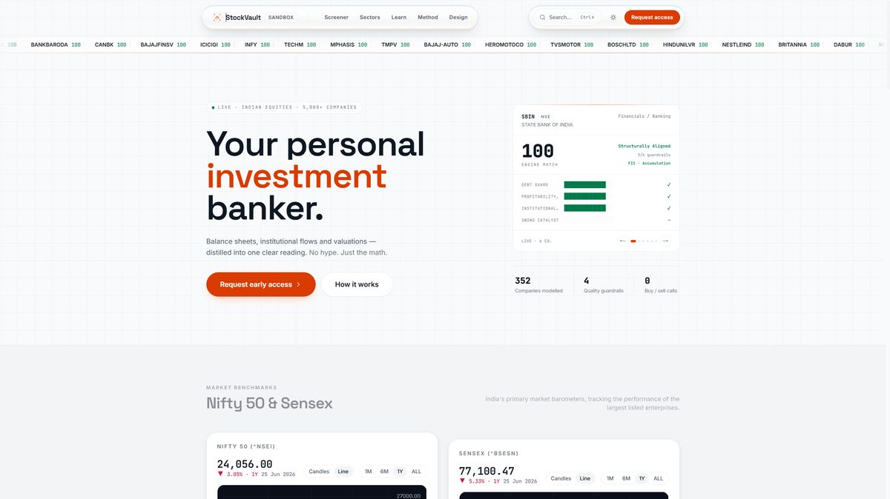
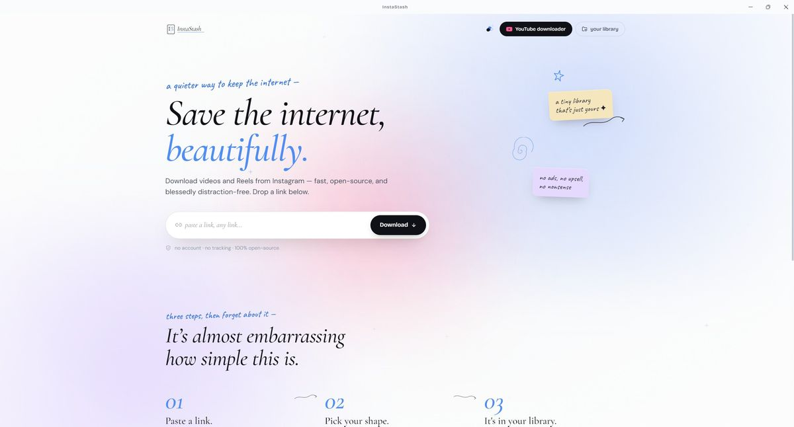
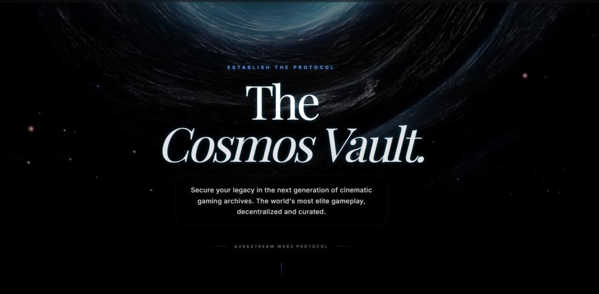
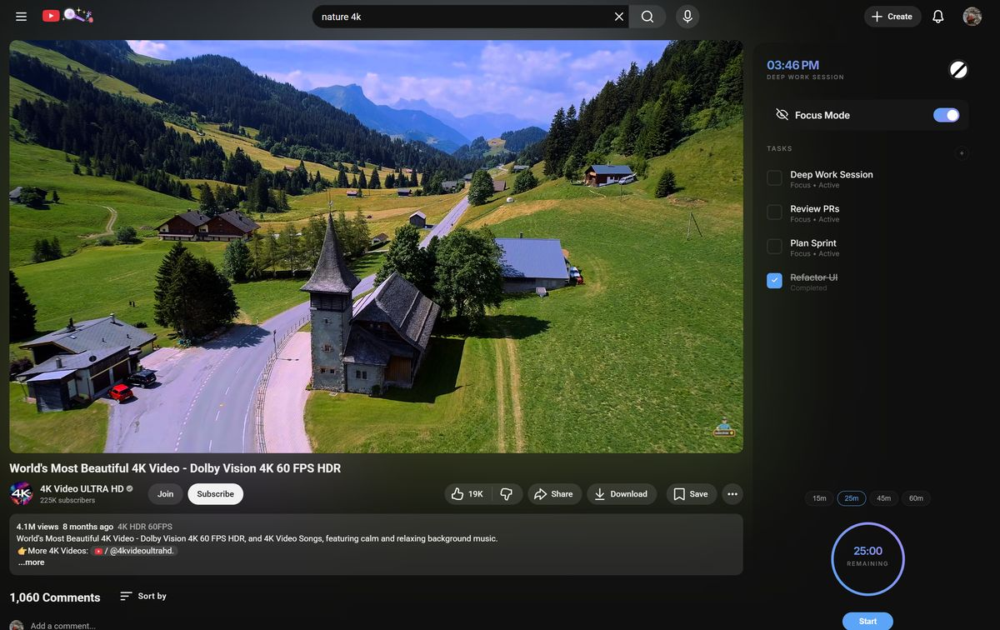
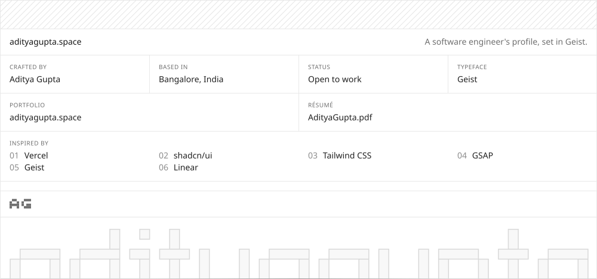

<picture>
  <source media="(prefers-color-scheme: dark)" srcset="./assets/banner-dark.svg">
  
</picture>

  <a href="https://adityagupta.space"><code>adityagupta.space</code></a> &nbsp;·&nbsp;
  <a href="https://www.linkedin.com/in/aditya-gup1a/"><code>LinkedIn</code></a> &nbsp;·&nbsp;
  <a href="https://leetcode.com/u/xcyberpunkx0/"><code>LeetCode</code></a> &nbsp;·&nbsp;
  <a href="mailto:adityagup1a@gmail.com"><code>Email</code></a> &nbsp;·&nbsp;
  <a href="https://adityagupta.space/resume/AdityaGupta.pdf"><code>Résumé (PDF)</code></a>

<picture>
  <source media="(prefers-color-scheme: dark)" srcset="./assets/title-hello-dark.svg">
  
</picture>

- I build products end to end, from the schema to the last hover state. Recently that meant a wholesale marketplace, a stock research tool, and a desktop vault for everything I learn.
- I care about the parts nobody asks for: how data moves, how an interface answers a click, and whether the system still holds when it gets busy.
- Looking for my next full-time role, and I can start right away.

<picture>
  <source media="(prefers-color-scheme: dark)" srcset="https://github-readme-activity-graph.vercel.app/graph?username=xcyberpunkx0&bg_color=0d1117&color=a0a0a0&title_color=fafafa&line=f26a50&point=eeeeee&area=true&area_color=f26a50&hide_border=true&custom_title=Recent%20commits">
  
</picture>

Fig. 2. Source: <a href="https://github.com/xcyberpunkx0">GitHub</a>

<picture>
  <source media="(prefers-color-scheme: dark)" srcset="./assets/title-stack-dark.svg">
  
</picture>

<picture>
  <source media="(prefers-color-scheme: dark)" srcset="./assets/stack-dark.svg">
  
</picture>

<picture>
  <source media="(prefers-color-scheme: dark)" srcset="./assets/title-experience-dark.svg">
  
</picture>

<b>TrueKhoj</b> &nbsp;·&nbsp; Software Engineer, Contract &nbsp;·&nbsp; May 2026 to Sep 2026 &nbsp;·&nbsp; Remote

- Led frontend on a dual-mode B2B/B2C wholesale marketplace built from scratch, running both Local Market and Online Store modes from a single Next.js (App Router), TypeScript and Supabase codebase.
- Built a drag-and-drop Store Builder (dnd-kit) with a block-based renderer for vendor storefronts, plus a reusable design system with semantic tokens, dark mode and mobile-first layouts.
- Architected the data layer on Supabase and PostgreSQL with sub-100ms queries through relational indexing, and integrated real-time search and OTP onboarding.

`Next.js` `TypeScript` `Supabase` `PostgreSQL` `dnd-kit` `Figma`

<b>The Aware AI</b> &nbsp;·&nbsp; Software Engineer &nbsp;·&nbsp; Jun 2025 to Dec 2025 &nbsp;·&nbsp; Hybrid

- Owned the real-time chat system across Web (React) and Mobile (Flutter) over WebSockets, delivering messages at 50ms latency with end-to-end encryption.
- Architected secure connection workflows (request, approval, access control) on Clean Architecture and microservices, lifting onboarding conversion by 35%.
- Aligned DTO contracts and schema validation between frontend and backend, cutting integration bugs by 25%.
- Shipped audio journal recording and playback on Web and Mobile.
- Ran deployments across Dev, Stage and Prod with Docker and CI/CD at 99.9% uptime over six months. Promoted from intern to full-time with 3x compensation growth.

`React` `Flutter` `WebSockets` `REST APIs` `Docker` `CI/CD` `Figma`

<b>Independent, Client Projects</b> &nbsp;·&nbsp; Web &amp; Mobile Developer, Contract &nbsp;·&nbsp; Jun 2024 to Apr 2025 &nbsp;·&nbsp; Hyderabad

- Built a cross-platform Flutter ordering app for a cafe so walk-in customers can browse the menu and order from their table. Owned requirements, UI, state management and REST integration through delivery.
- Delivered a production Next.js and Supabase site for a local F&amp;B business with mobile-first design, menu and order-enquiry flows, and on-page SEO, then handed it off to the owner.

`Flutter` `Dart` `REST APIs` `Next.js` `Supabase` `PostgreSQL` `SEO`

<b>Salesforce Supported Virtual Internship</b> &nbsp;·&nbsp; Salesforce Developer &nbsp;·&nbsp; Oct 2023 to Nov 2023 &nbsp;·&nbsp; Remote

- Shipped React UI components used by students and teachers, raising platform engagement by 25%.
- Integrated dynamic content (events, announcements, forms), reducing manual operations by 20%.
- Added client-side validation and feedback to forms, increasing successful submissions by 30%.

`React` `Salesforce` `Form Validation`

<picture>
  <source media="(prefers-color-scheme: dark)" srcset="./assets/title-projects-dark.svg">
  
</picture>

<b><a href="https://stockvault.space">StockVault</a></b> &nbsp;·&nbsp; Plain-English quality scores for 1,700+ Indian stocks &nbsp;·&nbsp; May 2026

 

A full-stack equity research platform that scores 1,700+ Indian stocks from 0 to 100 through a deterministic, four-guardrail Valuations Engine, and explains every verdict in plain English instead of acting as a black box. A provider-agnostic data layer swaps between a committed JSON snapshot, PostgreSQL, a live microservice and a mock at runtime, so it runs locally with zero infrastructure and builds in CI without secrets. Pages are cached at the edge for fast LCP while a request-coalesced quote proxy (FastAPI, yfinance) ticks the live price every 30s. Data refreshes weekly on GitHub Actions, with property-based tests guarding the engine.

**1,700+** stocks scored &nbsp;·&nbsp; **0 to 100** quality score &nbsp;·&nbsp; **4** guardrails

`Next.js 16` `React 19` `TypeScript` `Tailwind CSS 4` `PostgreSQL` `FastAPI` `AWS S3` &nbsp; [Read the case study](https://adityagupta.space/projects/stockvault)

<b><a href="https://github.com/xcyberpunkx0/trove">Trove</a></b> &nbsp;·&nbsp; Local-first knowledge vault with spaced repetition &nbsp;·&nbsp; Jul 2026

 

A local-first desktop vault (Tauri 2, React 19) built against the notes graveyard: everything you capture comes back on a spaced-repetition schedule. A Notion-style block editor with DSA templates, Mermaid diagrams and real code blocks feeds an SM-2 review scheduler with streaks, a 17-week heatmap and per-topic mastery rings. Problems log in 60 seconds from a pasted URL, get a reflective debrief, and keep brute-force and optimized solutions side by side. SQLite FTS5 search reaches notes, debriefs and the code itself. It ships as a native Windows app with a thin Rust shell: system tray, global quick-capture hotkey, signed auto-updates, and one local SQLite file you own. No account, no cloud, no telemetry.

**SM-2** review scheduler &nbsp;·&nbsp; **FTS5** search inside code &nbsp;·&nbsp; **100%** offline and local-first

`Tauri 2` `Rust` `React 19` `TypeScript` `SQLite` `Tailwind CSS 4` &nbsp; [Read the case study](https://adityagupta.space/projects/trove)

<b><a href="https://github.com/xcyberpunkx0/InstaStash">InstaStash</a></b> &nbsp;·&nbsp; Desktop app that saves reels straight to disk &nbsp;·&nbsp; Jun 2026

 

A cross-platform desktop app (Electron, Next.js) that saves Instagram reels and videos straight to disk. Paste a link, pick a quality, get a clean .mp4. It runs entirely on your machine with zero servers, wrapping yt-dlp and FFmpeg for fetching and audio/video muxing behind a hand-drawn paper notebook UI with real progress and a queue. Windows and macOS installers ship through a GitHub Actions release pipeline, backed by Vitest and fast-check suites.

**0** servers, fully local &nbsp;·&nbsp; **Win + Mac** installers shipped &nbsp;·&nbsp; **2** property-test suites

`Electron` `Next.js` `TypeScript` `FFmpeg` `yt-dlp` `Vitest` &nbsp; [Read the case study](https://adityagupta.space/projects/instastash)

<b><a href="https://aurastream.cloud">AuraStream</a></b> &nbsp;·&nbsp; Gameplay archive with zero video storage costs &nbsp;·&nbsp; Apr 2026

 

A cinematic gameplay archive where creators publish and share their best moments. Playback is offloaded to the YouTube iframe player, the Ghost Engine, so the platform pays nothing for video storage or encoding. PostgreSQL owns the product logic: private, unlisted and public visibility, a pending, approve or reject moderation pipeline, per-video view and watch-time analytics, and shareable creator profiles with vanity URLs. Google OAuth runs through NextAuth, and session-aware fuzzy search only surfaces public videos or your own.

**0 GB** video storage &nbsp;·&nbsp; **4-state** moderation flow &nbsp;·&nbsp; **3** visibility tiers

`Next.js` `React` `NextAuth.js` `PostgreSQL` `YouTube iframe API` `Tailwind CSS 4` &nbsp; [Read the case study](https://adityagupta.space/projects/aurastream)

<b><a href="https://chromewebstore.google.com/detail/clearfeed/pjhhcihepfhbglmkokbbiakkdnbaoiep">ClearFeed</a></b> &nbsp;·&nbsp; Chrome extension that strips YouTube distractions &nbsp;·&nbsp; Mar 2026

 

A Manifest V3 extension, live on the Chrome Web Store, that strips YouTube distractions with zero-lag pure CSS injection. Shipped through versioned releases (v1.0.4) with store compliance and a privacy policy. It includes a productivity dashboard with a custom Pomodoro timer and a contextual task manager, and a MutationObserver engine that edits the DOM without reloads across YouTube's SPA navigation.

**0ms** injection lag &nbsp;·&nbsp; **3** dashboard views &nbsp;·&nbsp; **Live** on the Chrome Web Store

`Vanilla JS` `CSS3` `DOM Events` `MutationObserver` `Manifest V3` &nbsp; [Read the case study](https://adityagupta.space/projects/clearfeed)

<picture>
  <source media="(prefers-color-scheme: dark)" srcset="./assets/title-recognition-dark.svg">
  
</picture>

> Your performance over the past quarter has been exceptional. You took on tasks outside your core domain and executed within the allocated time frame, maintaining quality and ownership throughout. Your willingness to step beyond your defined responsibilities have made a **measurable impact on delivery efficiency and team momentum.**
>
> <b>Management, The Aware AI.</b> Oct 2025. Came with a ~10% salary increment, effective November 2025.

- [**Google Cloud Platform Certification**](https://www.skills.google/public_profiles/8711ba1b-54e0-4b3c-8125-0911b884935b). Achieved in 2 months, covering cloud architecture, networking and services.
- [**Responsive Web Design Certification**](https://www.freecodecamp.org/certification/adityagup1a/responsive-web-design). FreeCodeCamp, after 300+ hours of coursework.
- [**Hacktoberfest Contributor, 2019 to 2022**](https://github.com/xcyberpunkx0). 20+ open-source projects over four years.

<picture>
  <source media="(prefers-color-scheme: dark)" srcset="./assets/title-education-dark.svg">
  
</picture>

| | |
|:--|--:|
| **B.Tech in Computer Science and Engineering** ITER, SOA University, CGPA 8.01 | <code>Aug 2019 to Aug 2023</code> |
| **Higher Secondary Education** Amrita Vidyalayam | <code>2017 to 2019</code> |

<picture>
  <source media="(prefers-color-scheme: dark)" srcset="./assets/footer-dark.svg">
  
</picture>

  

